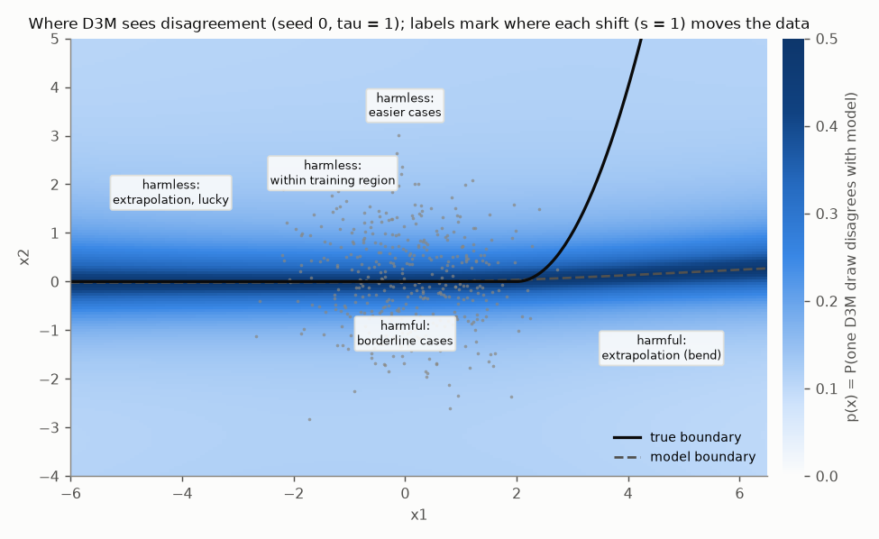
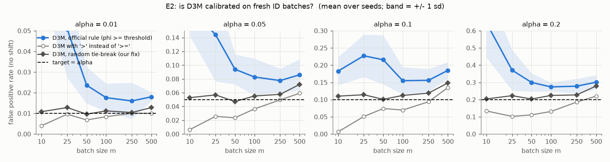
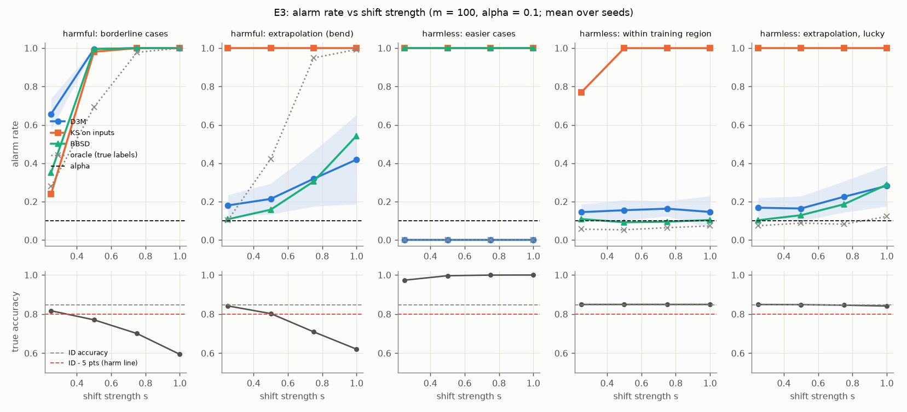
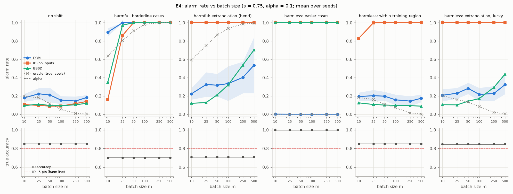
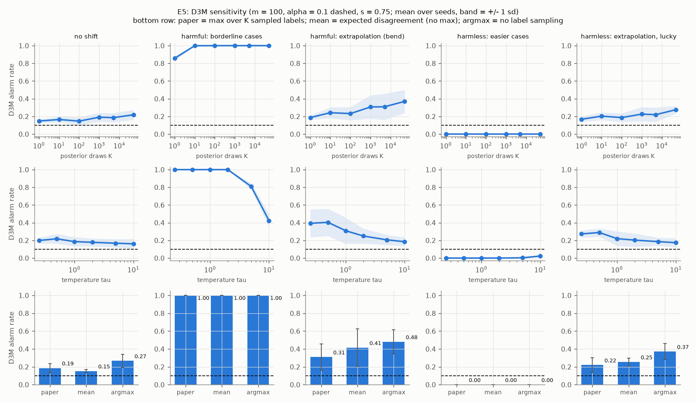
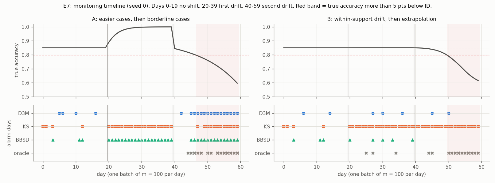

# Feasibility report: D3M, label-free detection of model deterioration

**Paper:** Nguyen, Shui, Giri, Arya, Verma, Razak, Krishnan. *Reliably Detecting Model Failures in Deployment Without Labels.* NeurIPS 2025 ([arXiv:2506.05047v4](https://arxiv.org/abs/2506.05047), [official code](https://github.com/teivng/d3m), commit `a73eb2d`).
**Setting:** 2-D synthetic binary problem with a known labelling rule; VBLL base model; 5 seeds; laptop CPU (Intel i5-7200U, 2 cores).
**Every number below comes from `results/spike_results.json`** (tables: `results/tables.md`, generated by `summarize_results.py`) unless it is explicitly marked as not run.

---

## 1. Verdict: **YELLOW** (workable, with a stated adjustment)

D3M reproduces the paper's central selling point. On a harmless shift towards *easier* inputs, D3M's alarm rate is **0.00** while both baselines alarm on **1.00** of batches. On a harmful shift towards *borderline* inputs it detects **1.00** of batches from m = 25 upwards (s = 0.75, α = 0.1, 5 seeds), and at m = 10 it is the most sample-efficient detector. The live demo responds in about **1.3 s** per interaction (target ≤ 60 s).

Three findings stop this from being GREEN:
1. **D3M misses confidently-wrong failures.** When the data moves into a region where the model extrapolates wrongly *but confidently*, D3M alarms on only **0.18–0.42** of batches (m = 100). This holds even though the true accuracy falls from 0.85 to 0.62. It alarms almost as often (**0.16–0.28**) on the mirror-image shift where the model happens to be right. KS alarms on 1.00 of both.
2. **The official decision rule is miscalibrated.** With `φ̃ ≥ quantile`, the false positive rate (FPR) with no shift is **0.15–0.23 instead of 0.10**, because φ only takes the values j/m. Breaking ties at random fixes this (0.10–0.12 for m ≤ 250).
3. **A purely deterministic labelling rule could not show any D3M effect.** My first design gave the 2-D problem deterministic labels. The VBLL model was then so confident everywhere that the mean disagreement probability moved only from 0.120 (ID) to 0.124 (harmful shift, accuracy 0.59). This was an exploration run on one seed, not part of the 5-seed results.

**Adjustment:** present D3M on a problem whose labels are noisy near the boundary (borderline cases exist). Show the "borderline cases" shift as the harmful case D3M handles, and the "confidently-wrong extrapolation" as the documented failure. Report D3M's FPR with the tie-break fix alongside the official rule. With these choices the demo shows the paper's claim honestly, together with its limits.

**Summary.** D3M separates "data got easier" from "data got harder" very well. It does not see failures the model is confident about, and its official threshold rule fires more often than α.
**Key terms:** alarm rate, harmful versus harmless shift, confidently-wrong extrapolation, tie-induced miscalibration.

---

## 2. Corrections to the method summary

I read Sec. 2.2–2.5 and Appendices A–C of the paper, and the official code (`d3m/monitors/bayesian_monitor.py`, `monitor.py`, `utils.py`, `models/mlp_model.py`, `experiments/run.py`, the configs). Most of your summary is right. These points need correcting or sharpening.

1. **"Other plausible models that agree with f on the training data"** describes *Idealized* D3M (App. A, Algorithms 1–2), which searches a set Hp of models with low training error. The practical D3M does **no search and never looks at the training data again**. It samples from the VBLL posterior. The authors' own App. C.4 shows that the sampled "models" have **11–15 % lower training accuracy** than the validation accuracy, so they are *not* in Hp. The theoretical guarantees (Theorems A.3–A.6) are proven only for the idealized version.
2. **A "posterior sample k" is not one alternative model.** In the code, `ll_dist.rsample([K])` draws logits **independently for every input**, from a separate Gaussian per input. So DisRate(k) is not "the disagreement rate of model k". It is an average of m independent coin flips. Consequence: the K values DisRate(1..K) are i.i.d., and φ is just the largest of K such averages. Its distribution depends only on each point's disagreement probability pᵢ (Sec. 6 explains why this matters).
3. **Pseudo-labels:** the paper says 2K draws, K of them for a Monte Carlo estimate of the mean model. The code instead takes `argmax` of the **mean logits** (`ll_dist.loc`), with no sampling. For two classes the two are identical.
4. **Two sources of randomness, not one.** Each logit draw is passed through a temperature-scaled softmax, and then a label is **sampled** from it ("double sampling"). The paper (App. C.5) says that without the second step VBLL disagreement "collapses" to about 5 %. The label sampling adds back randomness the posterior itself does not have, and that randomness is mostly *aleatoric*, i.e. "this point is near the boundary".
5. **Temperature direction:** logits are **divided** by τ, so τ > 1 flattens the softmax. The paper is internally inconsistent here. Sec. 3.1 says a larger τ allows "perfect TPR but also maximal FPR", while App. C.3 and Fig. 7 say TPR *collapses* as τ grows. My E5 agrees with App. C.3.
6. **Decision rule and α in practice:** the code alarms if `max_dis_rate >= np.quantile(Phi, 0.95)` (default quantile level 0.95, i.e. α = 0.05). The paper's experiments use α = 0.10, and α = 0.05 for GEMINI. The `≥` together with the discrete φ is what inflates the FPR (finding 2 above).
7. **Defaults:** K = 5000 posterior draws and |Φ| = T = 1000 calibration rounds for every dataset; τ = 1 (UCI, GEMINI, CIFAR) or 2 (Camelyon17). The VBLL head is `vbll.DiscClassification` with a **diagonal** covariance and KL weight 100/n. Its logit distribution also contains a learned, input-independent **noise** variance, so not all of the logit variance is weight uncertainty.
8. **"Harmless = the model's extrapolation is still correct" is not the paper's definition.** The paper calls a shift *non-deteriorating* only if **no** well-performing model disagrees more with f on the new data than on ID data (Def. 2, "D-PDD"). A shift into an unseen region where f happens to be right still counts as deteriorating if other plausible models would extrapolate differently. No label-free method can know which extrapolation is true. I therefore built two kinds of harmless shift:
   - one where every plausible model agrees ("easier cases", and moving within the training region);
   - your version ("lucky extrapolation"), kept as a stress test.
9. **"No training data needed at deploy time" is true**, but the monitor needs a held-out ID validation set before deployment and the stored Φ. Note also how the paper tuned it (App. B.5):
   - Hyperparameters were swept per dataset to give low ID FPR **and high TPR on the deteriorating test data**.
   - Seeded runs were **repeated until 10 runs with ID FPR < 0.10 were found**. Only those runs' TPRs are reported.
   - Both are optimistic selection steps. I do neither: all 5 seeds are reported, with fixed settings taken from the paper.
10. **The theory's assumptions** (App. A):
    - binary classification;
    - covariate shift only (the labelling rule does not change);
    - **deterministic** ground-truth labels;
    - an exact optimisation oracle over Hp.

    The authors list noisy labels as future work (Sec. 5).

**Summary.** Practical D3M is "sample labels from a slightly widened posterior and count how often they disagree with the model". It is an approximation without guarantees of the "search for the most disagreeing plausible model" idea in the theory.
**Key terms:** Idealized vs practical D3M, per-input independent sampling, double sampling, D-PDD.

---

## 3. What I ran

| ID | What | Settings | Seeds | Runtime |
|---|---|---|---|---|
| — | Base model | MLP 2→32 + 3 residual ELU blocks, dropout 0.2, `vbll.DiscClassification` (diagonal, KL weight 100/n, prior 1, Wishart 1); AdamW lr 1e-3, wd 1e-4, batch 64, 50 epochs; n_train = 2000, n_val = 2000 | 0–4 | 18.6 ± 1.0 s per model |
| E1 | Sanity: ID accuracy, posterior behaviour per shift | 5000 points per condition, s = 1 | 0–4 | < 1 s |
| E2 | No-shift FPR | 500 fresh ID batches per m; m ∈ {10, 25, 50, 100, 250, 500}; α ∈ {0.01, 0.05, 0.1, 0.2} | 0–4 | 16–17 s per seed |
| E3 | Alarm rate vs shift strength | 5 shift types × s ∈ {0.25, 0.5, 0.75, 1} + no shift; m = 100, α = 0.1; R = 200 batches each | 0–4 | 50–52 s per seed |
| E4 | Alarm rate vs batch size (Panel B) | 6 conditions × 6 values of m; s = 0.75; R = 200 | 0–4 | 100–107 s per seed |
| E5 | Sensitivity | K ∈ {1, 10, 100, 1000, 5000, 50000}; τ ∈ {0.25, …, 10}; "mean instead of max"; "argmax instead of sampled labels"; T ∈ {20, …, 1000} with 20 recalibrations each; VBLL KL factor ∈ {1, 100, 1000} (retrained) | 0–4 | 25 s + 38 s per seed |
| E6 | Live-demo timing | calibration per m, one full interaction, drawing, literal engine | 0 | 10 s |
| E7 | Timeline (Panel C) | 60 days, m = 100 per day, two scenarios | 0–4 | 6 s per seed |

The D3M settings follow the paper: K = 5000, T = 1000, τ = 1. **Total wall-clock for `run_spike.py`: 21.9 min.** The notebook executes end to end in 68 s.

**How D3M is computed.** `src/d3m.py` has two engines that produce the same random variable φ:
- **Literal engine:** steps 1–6 exactly as in the paper and the code. It draws K × m × C Gaussians, applies the softmax and samples labels.
- **Exact engine:** uses the independence from correction 2.
  1. Compute each point's disagreement probability pᵢ. For two classes this is a 1-D Gaussian integral, done with 64-point Gauss–Hermite quadrature.
  2. Compute the exact distribution of the number of disagreements (a Poisson-binomial distribution) with a small dynamic programme.
  3. Draw the maximum of K i.i.d. copies by inverse-CDF sampling, using P(max ≤ j) = F(j)ᴷ.

The two engines agree statistically. `tests/test_d3m.py` checks literal vs exact, brute-force coin flips vs the dynamic programme, and quadrature vs Monte Carlo. All 14 tests pass. The literal engine needs 4.0 s for T = 50 calibration rounds at m = 100. Scaling linearly, a single paper-sized calibration (T = 1000) would take about 80 s (extrapolated, not run), and the full experiment grid would take hours on this laptop. The exact engine needs 0.07 s for the same calibration with T = 1000.

---

## 4. Results

**Accuracy.** The base model reaches ID accuracy **0.848 ± 0.001**. The best possible (Bayes) accuracy under the labelling rule is 0.850, measured on seed 0 during exploration.

### 4.1 Why D3M sees what it sees (E1)

| condition (s = 1) | true acc | mean posterior sd of logit gap | mean pᵢ (sampled labels) | mean pᵢ (argmax only) |
|---|---|---|---|---|
| no shift | 0.849 | 0.72 | 0.261 | 0.089 |
| harmful: borderline cases | **0.594** | 0.57 | **0.429** | 0.305 |
| harmful: extrapolation (bend) | **0.621** | **0.72** | **0.276** | 0.106 |
| harmless: easier cases | 1.000 | 0.99 | 0.121 | 0.009 |
| harmless: lucky extrapolation | 0.841 | 0.72 | 0.270 | 0.099 |

Reading the table:
1. In the bend the model is wrong on about a quarter more of the points.
2. Yet its posterior is exactly as wide as on ID data (sd 0.72), and the mean disagreement probability barely moves (0.261 → 0.276).
3. D3M can only react to pᵢ, so it has almost nothing to react to.
4. The "lucky" mirror shift moves pᵢ by a similar amount (0.270).

The VBLL posterior does widen with distance from the data. In an earlier exploration run (seed 0, the first design with deterministic labels), the weight part of the logit variance grew from 0.002 near the data to 0.04 at |x₁| = 6. But that is negligible next to logit means of about ±3.

### 4.2 Calibration with no shift (E2)

At α = 0.1:

| m | official `≥` | `>` | random tie-break (fix) | distinct values in Φ |
|---|---|---|---|---|
| 10 | 0.18 ± 0.04 | 0.01 | 0.11 ± 0.01 | 4.8 |
| 25 | 0.23 ± 0.06 | 0.05 | 0.11 ± 0.01 | 7.2 |
| 50 | 0.22 ± 0.07 | 0.07 | 0.10 ± 0.01 | 9.8 |
| 100 | 0.15 ± 0.04 | 0.07 | 0.11 ± 0.01 | 13.6 |
| 250 | 0.16 ± 0.03 | 0.09 | 0.12 ± 0.01 | 19.8 |
| 500 | 0.18 ± 0.02 | 0.13 | 0.15 ± 0.02 | 26.2 |

- **Ties.** The max over 5000 draws squeezes Φ onto a handful of values. On average 13–21 % of the calibration rounds sit at or above the 0.9-quantile, instead of 10 %. At α = 0.2 and m = 10 the official FPR is **0.65 ± 0.20**. At α = 0.01 and m = 10 it is 0.13 instead of 0.01.
- **Finite calibration set.** Calibration bootstraps from only 2000 validation points. When m = 500 is a quarter of that set, Φ misses the variation between that validation sample and the true population, so even the fixed test reaches 0.15. Practical rule: keep the validation set at least about 10 × m.
- **Baselines.** At m = 100, KS has FPR 0.11 ± 0.03 and BBSD 0.10 ± 0.01. Both are well calibrated.

### 4.3 Harmful vs harmless shift (E3, the paper's core claim)

All rates at m = 100, α = 0.1, mean over 5 seeds. "D3M (fix)" uses the random tie-break.

| shift | s | true acc | D3M | D3M (fix) | KS | BBSD | oracle |
|---|---|---|---|---|---|---|---|
| none | 0 | 0.849 | 0.15 | 0.11 | 0.10 | 0.10 | 0.07 |
| harmful: borderline | 0.25 | 0.817 | 0.66 | 0.55 | 0.24 | 0.35 | 0.28 |
| harmful: borderline | 0.5 | 0.771 | **1.00** | 0.99 | 0.98 | 1.00 | 0.69 |
| harmful: extrapolation | 0.5 | 0.803 | 0.21 | 0.16 | 1.00 | 0.16 | 0.42 |
| harmful: extrapolation | 1.0 | 0.621 | **0.42 ± 0.23** | 0.34 | 1.00 | 0.54 | 0.99 |
| harmless: easier | 0.25–1 | 0.97–1.00 | **0.00** | 0.00 | **1.00** | **1.00** | 0.00 |
| harmless: within support | 0.25–1 | 0.849 | 0.14–0.16 | 0.09–0.11 | 0.77–1.00 | 0.09–0.11 | 0.05–0.07 |
| harmless: lucky extrapolation | 1.0 | 0.841 | 0.28 | 0.20 | 1.00 | 0.29 | 0.12 |

- **Confirms:** low alarm rates on non-deteriorating shifts while the baselines alarm.
  - Easier cases: D3M 0.00, KS and BBSD 1.00.
  - Within support: D3M stays at its own no-shift level, while KS is at 1.00.
- **Confirms:** high TPR on a deteriorating shift that adds uncertainty (borderline cases).
- **Contradicts** the general claim for deterioration the model is confident about. In the bend, D3M's TPR is 0.21 at s = 0.5 and 0.42 at s = 1, where the accuracy drops by 23 points. Across seeds it ranges from 0.07 to 0.76, depending on how each trained model happens to extrapolate.
- **Qualifies:** at s = 0.25 of the borderline shift (accuracy −3.2 points, below my 5-point "harmful" line) D3M already alarms on 0.66. That is sensitive, which is useful or not depending on how much drop you can tolerate.

### 4.4 How much data (E4, Panel B)

All at s = 0.75.
- **Borderline shift** (accuracy 0.70): at m = 10, D3M detects **0.90** (0.62 with the tie fix) versus KS 0.16 and BBSD 0.35. All detectors reach 1.00 by m = 50. This supports the paper's point that D3M needs few samples, *for this kind of shift*.
- **Extrapolation** (accuracy 0.71): D3M rises slowly from 0.22 (m = 10) to 0.53 ± 0.31 (m = 500). BBSD passes it at m ≥ 250 (0.70 at m = 500). KS is at 1.00 at every m.
- **Easier cases:** D3M is at 0.00 at every m, KS and BBSD at 1.00.
- **No shift:** D3M's official FPR is 0.14–0.22 at every m; it does not shrink with more data.

### 4.5 Sensitivity (E5)

All at m = 100, s = 0.75.
- **K (number of draws)** moves φ and the threshold up together. The mean ID φ goes 0.263 → 0.428 → 0.453 for K = 1, 5000, 50000, and the threshold goes 0.314 → 0.450 → 0.472. Detection barely changes: borderline 0.86 at K = 1, then 1.00 from K = 10 on.
- **Temperature τ:** a high τ destroys detection. Borderline TPR falls from 1.00 (τ ≤ 2) to 0.81 (τ = 5) and 0.42 (τ = 10), which agrees with the paper's App. C.3. A lower τ helps the extrapolation case only slightly (0.39–0.40 at τ ≤ 0.5) and raises the no-shift FPR to 0.20–0.22.
- **"Mean instead of max":** replace φ = max over K by its expectation, the mean disagreement probability. This is **as good or better**: no-shift FPR 0.15 vs 0.19, extrapolation 0.41 vs 0.31, borderline 1.00 vs 1.00. The max-over-K step adds nothing measurable here.
- **"Argmax instead of sampled labels"** (no double sampling): no-shift FPR rises to 0.27, because φ is small and even more tied. Easier cases stay at 0.00.
- **T (calibration rounds):** across 20 recalibrations the threshold sd is 0.008 at T = 20 and 0.002 at T = 1000. The ID FPR sd across recalibrations is 0.10 at T = 20 and 0.04 at T = 1000. Use T ≥ 500.
- **VBLL KL factor:**
  - 1 or 1000 instead of 100 leaves the ID accuracy at 0.848.
  - Factor 1000 lowers borderline detection to 0.77.
  - No setting rescues the extrapolation case (0.20–0.31).

### 4.6 Timeline (E7, Panel C)

Mean over 5 seeds, 60 days, m = 100 per day.
- **Scenario A** (days 20–39 easier cases, then borderline cases from day 40; accuracy crosses −5 points on day 47):
  - False alarms on the 47 OK days: D3M **6.6**, KS 23.4, BBSD 24.4, oracle 2.6.
  - Delay after onset: D3M 0.0 days, KS 0.6, BBSD 0.2.
  - Alarm rate after onset: D3M 1.00.
- **Scenario B** (days 20–39 within-support drift, then extrapolation; onset on day 49–51):
  - D3M: 6.8 false alarms and a delay of 2.2 ± 2.0 days, but it alarmed on only **0.31** of the deteriorated days.
  - KS: 1.00 after onset, but 30.2 false alarms.
  - BBSD: 0.20 after onset, and it never fired in 1 of 5 seeds.

### 4.7 Confirm / qualify / contradict

| Paper claim | My result |
|---|---|
| Low FPR on non-deteriorating shifts where baselines alarm | **Confirmed** (easier cases 0.00 vs 1.00; within support at D3M's own ID level) |
| FPR ≈ α (immediate control over FPR, Sec. 2.2) | **Contradicted** with the official `≥` rule (0.15–0.23 at α = 0.1); holds after a random tie-break for m ≤ 250 |
| High TPR on deteriorating shifts | **Qualified:** yes when the shift adds borderline cases (1.00 from m = 25); no when the model is confidently wrong (0.21–0.42 at m = 100) |
| Few samples needed; more deterioration → fewer samples | **Confirmed** for borderline cases (best detector at m = 10) |
| Noisy at small m (Table 2 has large sd) | **Confirmed:** large seed-to-seed spread on the extrapolation shift (0.07–0.76 at s = 1) |
| Temperature τ in 1–5 is a stable range | **Confirmed:** τ = 10 halves the TPR |

---

## 5. Demo plan

**Live parameters (Panel A):**
- shift type (6 options) and strength s ∈ [0, 1];
- batch size m ∈ {10, 25, 50, 100, 250, 500};
- α ∈ [0.01, 0.3];
- K ∈ {1, …, 50000} and τ ∈ {0.25, …, 10};
- the random batch seed.

**What is precomputed and what runs live:**

| Step | When | Time (measured) |
|---|---|---|
| Train the base model | once, by `run_spike.py` (checkpoint); the notebook retrains if the file is missing | 18–21 s |
| Calibrate Φ for the 6 m values (T = 1000, K = 5000) | notebook start-up | 3.9 s in total |
| A new (K, τ) pair → recalibrate Φ for the current m | on change | 0.01 s (m ≤ 50) to 3.5 s (m = 500) |
| Sample batch, D3M test, KS, BBSD, true accuracy | every interaction | 0.06 s at m = 500 |
| … plus redrawing Panel A | every interaction | 1.1–1.3 s |
| Panel B live sweep (R = 100, 6 values of m, 2 conditions) | on demand | 17–21 s |
| Panel C timeline (60 days) | on demand | 3.7 s |

**Suggested live sequence:**
1. Borderline cases, s = 0.5. All three detectors alarm; the accuracy is 0.77.
2. Switch to **easier cases**. Only KS and BBSD alarm; the accuracy rises to 1.00. This is the paper's point.
3. Switch to **extrapolation (bend)**, s = 0.75. Accuracy is 0.71, KS alarms, and D3M is quiet on about 2 of 3 batches. Change the batch seed to show this. This is the weak point.
4. Switch to **lucky extrapolation**. KS still alarms, and D3M fires about as often as in step 3, so it cannot tell the two apart.
5. Set τ = 10 on the borderline shift. φ̃ and Φ both move towards 0.5, and the alarm becomes unreliable.

If the widgets do not render, a fallback cell runs the same functions with plain variables. Stored figures from the 5-seed run are at the end of the notebook.

---

## 6. Critical assessment

**What D3M really measures (the mechanism, step by step):**
1. For each input, VBLL gives a Gaussian over the logit gap with mean a (the distance from the model's boundary) and sd b.
2. One D3M draw disagrees with the model with probability pᵢ = E[sigmoid(−gap/τ)]. pᵢ is large when the point is near the model's boundary or when the posterior is wide.
3. DisRate(k) is the average of m independent coin flips with these pᵢ, so its expected value is the batch's mean pᵢ.
4. φ = max over K of these averages = mean pᵢ plus a "max bonus" that depends only on K and m.
5. **So D3M is a one-sided test of "is the batch's average predictive uncertainty higher than usual?"** E5 supports this: the plain average with no max is equally good or better.

**Summary.** D3M is a confidence monitor dressed as a hypothesis search.
**Key terms:** disagreement probability pᵢ, Poisson-binomial distribution, one-sided test.

**Assumptions and where they bite (with my numbers):**
- **The posterior must widen where the model is wrong.** With VBLL it does not, in any useful way. In the bend, the posterior sd of the gap is 0.72, the same as ID, and the mean pᵢ changes by only 0.015, while the accuracy falls by 0.23. This is the paper's own App. C.4/C.5 limitation ("lacking diversity"), shown concretely. The theory needs samples from Hp; C.4 shows VBLL samples are outside Hp, and my map shows they do not explore the alternative boundaries that matter.
- **Covariate shift only, labelling rule unchanged.** Under concept shift, where the same x gets a different label, nothing in x or in the model's confidence changes, so D3M is blind by construction. Not tested here.
- **"Harmless" is defined relative to the model's uncertainty, not the truth.** Moving towards easier inputs looks harmless to D3M, and that is correct. Moving into unseen territory where the model is right by luck looks the same to D3M as moving where it is wrong by bad luck: 0.28 vs 0.42 alarm rate. KS alarms on both. No label-free method can do better without extra knowledge.
- **α is not what you get.** Ties plus the `≥` rule give 1.5–2.3 × α at α = 0.1. A finite validation set inflates the FPR further when m is close to n_val.
- **m trades speed for noise.** D3M is strongest at small m for uncertainty-type shifts, but its decisions vary a lot between seeds for the hard shift (sd up to ±0.31).
- **The paper's own evaluation is optimistic.** Hyperparameters were chosen using the deteriorating test data, and only seeds with ID FPR < 0.10 were kept. I did neither, and my ID FPR with the official rule is above 0.10 for every m.

**Weakest point.** In the setting where monitoring matters most, the model is *silently* and *confidently* wrong on new data. Practical D3M has little to measure there, because its "alternative models" are random perturbations around the deployed model's own confidence. It is not a search for plausible models that extrapolate differently. In my run this gives 0.42 detection at a 23-point accuracy drop, against 1.00 for a plain KS test.

**What would plausibly fix it (not run):**
- a posterior that actually varies the extrapolation: deep ensembles, or the paper's own fully Bayesian network from App. C.5;
- an explicit Detectron-style search (needs the training data);
- reporting D3M's p-value with tie-breaking;
- a larger validation set.

---

## 7. Five "predict, then run" questions

All answers come from the stored 5-seed results. The settings are m = 100, α = 0.1, K = 5000, τ = 1 unless stated otherwise.

**Q1. "I halve the batch size from 100 to 50 on the borderline-cases shift (s = 0.75). What happens to D3M's alarm?"**
**Answer:** it still alarms on 1.00 of batches.
1. With fewer points, each average is noisier, so the max over K draws is higher. The threshold therefore rises: 0.450 → 0.528.
2. The query's φ̃ rises by about the same amount: 0.539 → 0.613.
3. The gap above the threshold (about 0.09) is unchanged, because it comes from the shift in the mean pᵢ (more borderline points), which does not depend on m.
4. Only at m = 10 does detection drop, to 0.90.

**Q2. "I set the temperature τ from 1 to 10. Does D3M detect the borderline shift better or worse?"**
**Answer:** worse, falling from 1.00 to 0.42.
1. Dividing logits by 10 makes every softmax close to 50/50.
2. Every point then disagrees about half the time, whether it is borderline or not.
3. The ID mean φ rises from 0.43 to 0.65, and the difference between ID and shifted batches shrinks.
4. This matches App. C.3 of the paper.

**Q3. "I set K = 10 instead of 5000. Will φ̃ go up or down, and will the alarm change?"**
**Answer:** φ̃ goes down, but the alarm hardly changes.
1. The maximum of 10 draws is smaller than the maximum of 5000: the mean ID φ falls from 0.428 to 0.330.
2. The threshold is computed with the same K, so it falls too, from 0.450 to 0.362.
3. Only the gap between φ̃ and the threshold matters. Borderline detection stays at 1.00, and the no-shift FPR goes from 0.19 to 0.16.
4. Rule: **K moves both sides of the test**.

**Q4. "Switch to 'harmless: easier cases' at s = 0.25. Which detectors alarm?"**
**Answer:** KS 1.00, BBSD 1.00, D3M 0.00, and the true accuracy rises to 0.97.
1. Both baselines test "is anything different?", and the inputs and the predicted probabilities clearly changed.
2. D3M only alarms if disagreement goes *up*. Moving points away from the boundary makes the model more confident, so φ̃ goes *down*. At s = 0.75 the mean φ̃ is 0.265 against a threshold of 0.450 (E4).

**Q5. "Harmful extrapolation at full strength: accuracy drops from 0.85 to 0.62. Will D3M alarm, and will a bigger batch fix it?"**
**Answer:** probably not; it alarms on 0.42 of batches at m = 100, with 0.07–0.76 depending on the seed. At s = 0.75, going from m = 100 to 500 only raises it from 0.34 to 0.53 ± 0.31.
1. The model is *confidently* wrong in the bend.
2. Its posterior is no wider there (sd 0.72, as on ID data), so the mean pᵢ barely moves: 0.261 → 0.276.
3. More data only shrinks the noise around a very small difference.
4. KS alarms on 1.00 here, but it also alarms on 1.00 for the harmless lucky mirror shift.

**Bonus Q6. "Why does D3M alarm on 15–20 % of batches when nothing has changed, if α = 0.1?"**
**Answer:**
1. φ can only take the values j/m.
2. The threshold usually lands exactly on one of those values, which many calibration rounds share.
3. With `≥`, all those ties count as alarms.
4. Breaking ties at random brings the FPR back to 0.10–0.12. Measured: m = 100, official 0.15, fixed 0.11.

---

## 8. Simplifications vs the paper

- **Data:** a 2-D synthetic binary problem with a known labelling rule, noisy within about 0.3 of the boundary. The paper uses UCI Heart Disease, CIFAR-10/10.1, Camelyon17 and GEMINI. My labels are noisy, whereas the paper's theory assumes deterministic labels; with deterministic labels D3M showed no effect (Sec. 1).
- **Model:** hidden width 32 with 3 residual blocks and 50 epochs (the paper's UCI setting is width 16 with 4 layers). The same `vbll` package and settings are used: diagonal covariance, KL factor 100, prior 1, Wishart 1.
- **D3M:** the paper's algorithm is implemented literally, but experiments use an exact, faster engine that draws from the same distribution (checked by tests). Pseudo-labels use the argmax of the mean logits, as in the official code. Query batches are drawn fresh from the shifted distribution, not bootstrapped from a finite deployment set.
- **Baselines:** only per-feature KS (Bonferroni), BBSD (KS on predicted probabilities) and an oracle. Not run: MMD-D, H-divergence, Relative Mahalanobis, deep-ensemble entropy, CTST, Detectron, an RBF-MMD test, and the fully Bayesian / deep-ensemble posterior ablation.
- **No hyperparameter sweep and no seed selection.** The paper selects both using the test data (Sec. 2, item 9).
- **α = 0.1** throughout, as in the paper's benchmarks. E2 also covers 0.01, 0.05 and 0.2.
- **"Harmful"** is defined as a population accuracy drop of more than 5 points, measured from the known labelling rule.
- **Not run:** concept shift, multi-class problems, real data, larger models, and any GPU runs.
